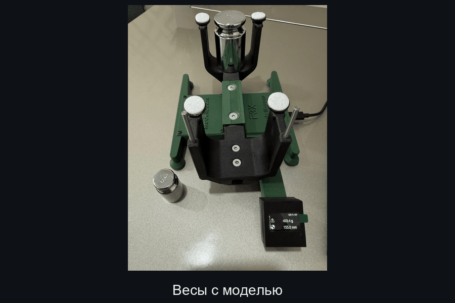
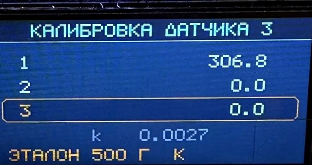
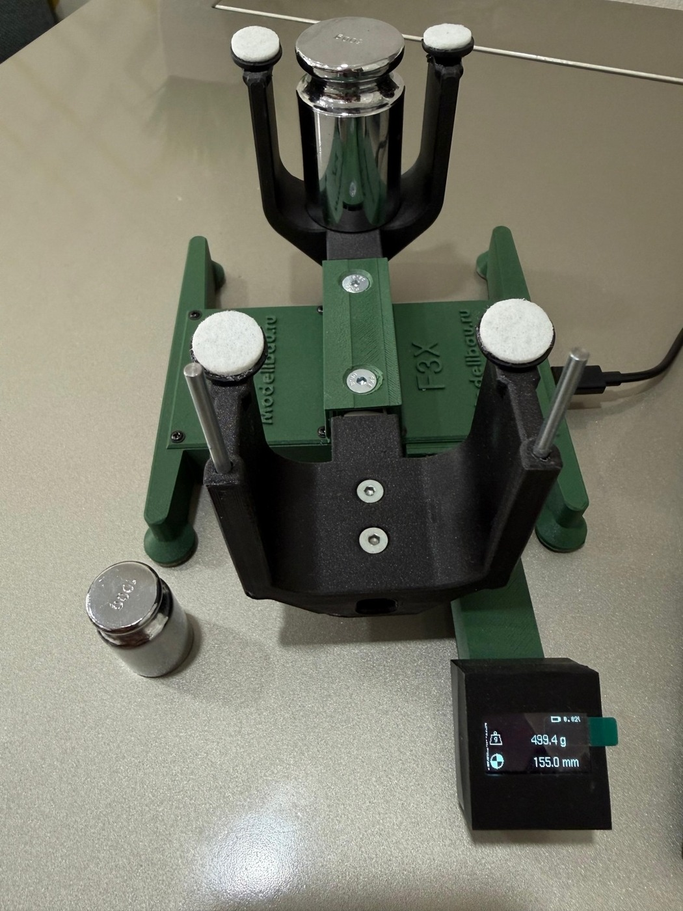
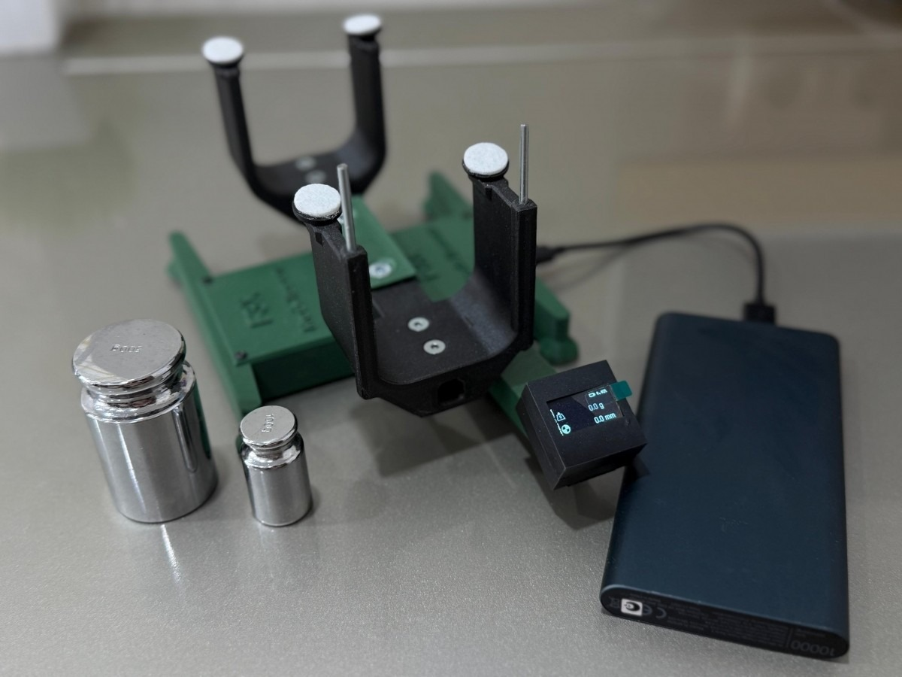
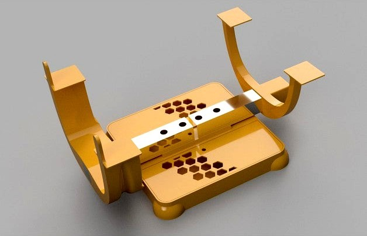

# CG_Scale — весы для определения центра тяжести авиамодели

ESP32 + три тензодатчика (2 опоры крыльев + задняя опора на центровой линии)
+ экран ST7789 320×170. Считает массу модели, центровку в мм от носа и
показывает разницу масс крыльев. Текущая версия прошивки — **v6.40**.



> Галерея собрана из реальных фото и рендера: экран калибровки, весы с моделью,
> железо, 3D-модель и схема опор. GIF пересобирается из `docs/screens/`
> командой `python tools/make_gallery.py` (нужен Python 3 и Pillow:
> `pip install pillow`).

## Железо и распиновка

| Узел | Пины |
|---|---|
| HX711 SCK (общий на 3 модуля) | GPIO27 |
| HX711 DOUT: датчик 1 (левое крыло) | GPIO26 |
| HX711 DOUT: датчик 2 (правое крыло) | GPIO25 |
| HX711 DOUT: датчик 3 (задняя опора) | GPIO33 |
| Дисплей ST7789 | CS 15, DC 2, RST 4, MOSI 23, SCLK 18, BL 32 |
| Кнопки | КН1 GPIO22, КН2 GPIO21 (на GND, подтяжка встроенная) |
| Заряд батареи | GPIO34 |

HX711 питать от 3.3 В (не 5 В!). Питание HX711 подаётся с задержкой,
есть контроль готовности датчиков при старте.

## Формулы

```
W  = w1 + w2 + w3
CG = X1 + (w3 * X2) / W        [мм от носа модели]
левое крыло  = w1 + w3/2
правое крыло = w2 + w3/2
```

X1, X2, X3 — геометрия опор (точки крепления), задаются и калибруются
в меню расстояний. Формулы не менять без полного пересчёта калибровок.

## Сборка и прошивка

```
arduino-cli compile --fqbn esp32:esp32:esp32 "C:\Users\user\Documents\Arduino\sketch_CG"
arduino-cli upload  --fqbn esp32:esp32:esp32 -p COM21 "C:\Users\user\Documents\Arduino\sketch_CG"
```

После прошивки — `read_com.ps1` (Temp\opencode): в логе должны быть
`BOOT OK / TARE OK / TFT OK / WIFI OK`, три датчика и геометрия X1/X2/X3.

Бэкапы `.ino` — в `C:\Users\user\Documents\Arduino\sketch_CG_backups\`
(вне папки скетча, иначе ломает компиляцию). Бэкап брать перед каждой прошивкой.

## Управление

- **КН1 коротко** — тарирование (обнуление) на главном экране.
- **КН2 коротко** — следующий вариант главного экрана (их 10, выбор
  запоминается в NVS `uivar`).
- **Обе кнопки 3 с** — вход в меню калибровки / переход между меню.
- В калибровке: КН2 коротко — сменить эталон, КН1 двойной — следующий
  датчик, КН2 3 с — калибровать.
- Меню расстояний: обе кнопки 3 с; выход — так же.
- **4 нажатия КН1** — тестовый экран.
- Память датчиков хранится в NVS (Preferences), переживает выключение.

## Экраны (v6.40)

10 вариантов главного экрана, листаются КН2, счётчик «N/10»:
8 выбранных из v6.30 (тёмная и светлые «три колонки», «чек», «сплит»,
тёмные «герой», «минимум») + 2 новых «приборные шкалы» (светлая и тёмная):
круглые шкалы массы (100 г → 2000 г вверх → 5 кг) и ЦТ
(50 → 100 мм вверх → 145 мм), показание в центре круга, вердикт внизу
(«КРЫЛЬЯ РОВНЫ» / «ЛЕВОЕ ТЯЖЕЛЕЕ НА 60 г» и т.п.).

### Фото и железо

| Экран калибровки | Весы с моделью |
|---|---|
|  |  |

| Железо и гири | 3D-модель корпуса |
|---|---|
|  |  |

Схема геометрии опор: [geometry_x1_x2_x3.svg](geometry_x1_x2_x3.svg)
(крупнее — [docs/screens/05-mechanics.png](docs/screens/05-mechanics.png)).

## Генераторы интерфейса (не править блок вариантов руками!)

Блок вариантов в `sketch_CG.ino` между маркерами
`БЛОК ВАРИАНТОВ: НАЧАЛО/КОНЕЦ` генерируется скриптами. В репозиторий они
не входят: раньше лежали в `%TEMP%\opencode`, а временная папка очищается.

| Скрипт | Что делает |
|---|---|
| `rad_variants.py` | **главный сборщик**: состав из 10 экранов (KEEP), тема каждого варианта явным флагом `dark`, эмиссия блока в `.ino`, превью `prev\v_all10.png` |
| `gen_variants.py` | раскладки 9 светлых вариантов-источников, аудит наложений |
| `gen_dials.py` | «приборные шкалы»: геометрия, палитры, превью и C++ (`dialFrame`/`dialDraw`) |
| `ui_glass.py` | класс превью (стиль «жидкое стекло»), смешивание цветов |
| `gen_font.py` | шрифт Bahnschrift (DIN) → `uifont.h` / `uifont.py` |

Если скрипты восстановлены в `tools/gen/`, запуск:
`python tools/gen/rad_variants.py` — перегенерирует блок в `.ino`, проверит
наложения и нарисует превью. После изменения блока — компиляция, превью,
бэкап, прошивка, обновление `ПРОЕКТ_СТАТУС.md`.

## Web-интерфейс

После старта ESP32 поднимает точку доступа **CG_Scale**, IP `192.168.4.1`
(WebServer на порту 80) — просмотр показаний из браузера.

## История проекта

Коротко, от первой рабочей версии до текущей. Полная хронология — в
[HISTORY.md](HISTORY.md), детали и логи прошивок — в
[ПРОЕКТ_СТАТУС.md](ПРОЕКТ_СТАТУС.md).

| Версия | Дата | Что сделано |
|---|---|---|
| v4.0–v4.3 | 06.10.2026 | Первая рабочая версия: ESP32 + 3×HX711 + ST7789, кириллица, две кнопки, VSPI 40 МГц |
| v4.4–v4.5 | 07.10.2026 | Диагностика датчиков; одновременное чтение HX711 — починен главный баг с общим SCK |
| v4.6–v4.9 | 07–08.10.2026 | Правильная распайка крыльев, мёртвая зона, калибровка по эталону, защита от фантомного веса |
| v5.0 | 08.10.2026 | Новое меню: обе кнопки 3 с, геометрия X1/X2/X3, шаг 0.1 мм, автоповтор |
| v5.1–v5.3 | 08–09.10.2026 | Отладка калибровки, пределы расстояний, мини-схема, эталон в строках датчиков |
| v5.4–v5.6 | 12–13.10.2026 | Исправлена обрезка кириллицы, новая мини-схема, ЦТ крупным оранжевым |
| v5.8 | 14–16.10.2026 | Главный экран с 3D-сценой, шарик ЦТ, автоподгонка кадра |
| v6.00–v6.10 | 26.10.2026 | Стиль «жидкое стекло», шрифт Bahnschrift, 9 вариантов экрана, листание КН2 |
| v6.20–v6.30 | 26.10.2026 | Плавная дуга без мигания, 18 вариантов (9 светлых + 9 тёмных) |
| v6.40 | 02.11.2026 | Финальные 10 экранов, приборные шкалы масса/ЦТ, исправлена тема тёмных |

Текущая прошивка — **v6.40**, прошита на COM21 02.11.2026.

## Автосохранение в GitHub

Раз в неделю, в понедельник в 12:00, задача Windows `CG_Scale weekly backup`
делает commit локальных изменений, забирает изменения с GitHub (`git pull
--rebase`) и отправляет всё обратно (`git push`). Лог —
`..\sketch_CG_backups\weekly-backup.log`.

Синхронизировать вручную: двойной клик по `tools\sync-now.cmd` или скажи
агенту «синхронизируй с GitHub» (есть команда `/sync`).

Установить или переустановить задачу:

```powershell
powershell -ExecutionPolicy Bypass -File tools\install-weekly-task.ps1
```

Если появилось `Access is denied` — запусти PowerShell от имени администратора.

Проверить:

```powershell
Get-ScheduledTask -TaskName "CG_Scale weekly backup"
```

Если компьютер был выключен в понедельник, задача выполнится при следующем
входе в систему. Автосохранение не зависит от OpenCode — оно работает само.

## Как продолжить на другом компьютере

Проект лежит на GitHub, поэтому на домашнем компьютере достаточно клонировать
репозиторий. Важно: папка должна называться `sketch_CG`, иначе Arduino IDE
не откроет `sketch_CG.ino`.

1. Установи Git, OpenCode и GitHub CLI.
2. Войди в GitHub (один раз):

   ```powershell
   gh auth login
   gh auth setup-git
   ```

   Выбирай GitHub.com → HTTPS → Login with a web browser.

3. Клонируй проект в папку `sketch_CG`:

   ```powershell
   cd "$env:USERPROFILE\Documents\Arduino"
   git clone https://github.com/permyakov344-png/CG_Scale.git sketch_CG
   ```

4. Открой OpenCode → **Open Folder** → выбери
   `...\Documents\Arduino\sketch_CG`.
5. Перед работой и после неё запускай `tools\sync-now.cmd` (двойной клик) —
   он забирает изменения с другого компьютера и отправляет твои.

Для компиляции и прошивки на домашнем компьютере нужны Arduino IDE/CLI,
ESP32 core и библиотеки Adafruit GFX + Adafruit ST7789. Путь в командах
`arduino-cli` из раздела «Сборка и прошивка» замени на свой.

## Файлы

- `sketch_CG.ino` — основной код (v6.40).
- `uifont.h` — шрифт (сгенерирован `gen_font.py`, скрипт в репозиторий не входит).
- `tft_setup.h` — legacy-настройки дисплея, скетчем не используются.
- `README.md` — этот файл: сборка, управление, экраны, история.
- `HISTORY.md` — короткая история проекта по версиям.
- `ПРОЕКТ_СТАТУС.md` — подробная история версий и чек-листы проверки на железе.
- `geometry_x1_x2_x3.svg` — схема геометрии опор.
- `docs/screens/` — фото экрана и железа, `demo.gif` для README.
- `tools/make_gallery.py` — пересборка `demo.gif` из `docs/screens/`.
- `tools/weekly-backup.ps1` — еженедельный commit + pull + push.
- `tools/sync-now.cmd` — то же самое вручную, двойным кликом.
- `tools/install-weekly-task.ps1` — установка задачи в Планировщик Windows.
- `..\sketch_CG_backups\` — бэкапы прошивок (вне папки скетча).
